# Doorstep

**An AI delivery agent for small PayPal sellers.** Refunds the buyer in minutes when a parcel goes
missing, proves who really had the parcel, and drafts a fact-checked claim so the seller can
recover the loss from the carrier.

[](https://github.com/DiyorbekImomaliyev/doorstep/actions/workflows/ci.yml)
[](LICENSE)
[](https://doorstep-ojmg.onrender.com)

**Live app:** https://doorstep-ojmg.onrender.com · PayPal sandbox and Shippo test mode · UK and US
orders

[Design](#design-at-a-glance) · [Try it](#try-it-in-60-seconds) · [Why it matters](#why-it-matters) ·
[What sellers say](#what-sellers-say) · [PayPal integration](#paypal-integration) · [Product tour](#product-tour) · [What makes it
different](#what-makes-it-different) · [How it compares](#how-it-compares) · [Quality](#quality) · [Run it locally](#run-it-locally)

## Overview

Today a courier's "Delivered" scan wins every argument. The buyer is told to wait, the honest seller pays for the parcel, and the carrier that lost it walks
away. UK law says the risk stays with the seller until the buyer **physically holds** the parcel ([Consumer Rights Act 2015,
s.29](https://www.legislation.gov.uk/ukpga/2015/15/section/29)), but nobody can cheaply prove possession.

Doorstep closes that gap inside PayPal. It runs every order through five stages (prevent, prove, resolve, recover, learn). When something still goes wrong, it
settles the money through PayPal's own APIs.

**One case, start to finish.** Royal Mail scans Diyorbek's £60 jacket "Delivered", and Diyorbek taps **Not here**. The audit finds the scan was made in E8, but the parcel
was going to N1. It was made in the same minute as two more of Malika's parcels to two other areas. The parcel was still Malika's risk, so Doorstep recommends a
refund and Malika approves it in one tap. The refund goes to Diyorbek through PayPal. Malika gets a Royal Mail claim pack, where every sentence cites a checked fact,
with the deadline from Royal Mail's own terms.

## Design at a glance

One FastAPI web service, one background worker and one Postgres, on Render. Models write words and plans; code decides who is liable and how much. Only
`app/policy` can move money, and every PayPal write goes through an outbox with one idempotency key. Click a diagram to open it full size.

**System architecture:** who talks to what, and the one path money takes.

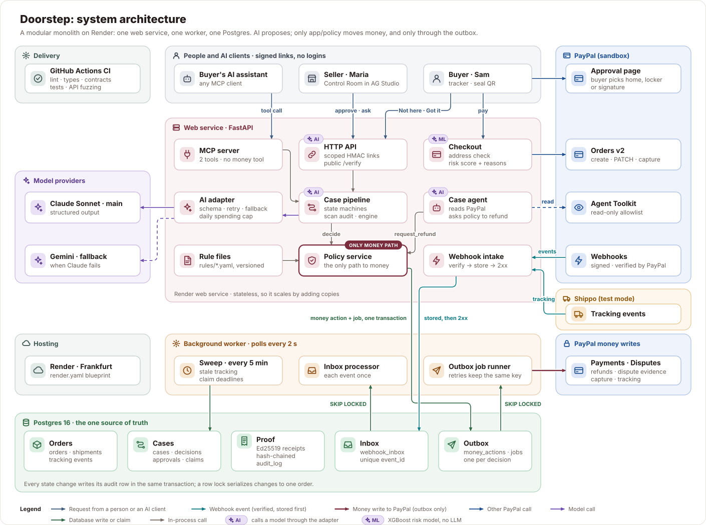

**Money path:** from "Not here" to a PayPal refund, exactly once, and what happens when a step fails.

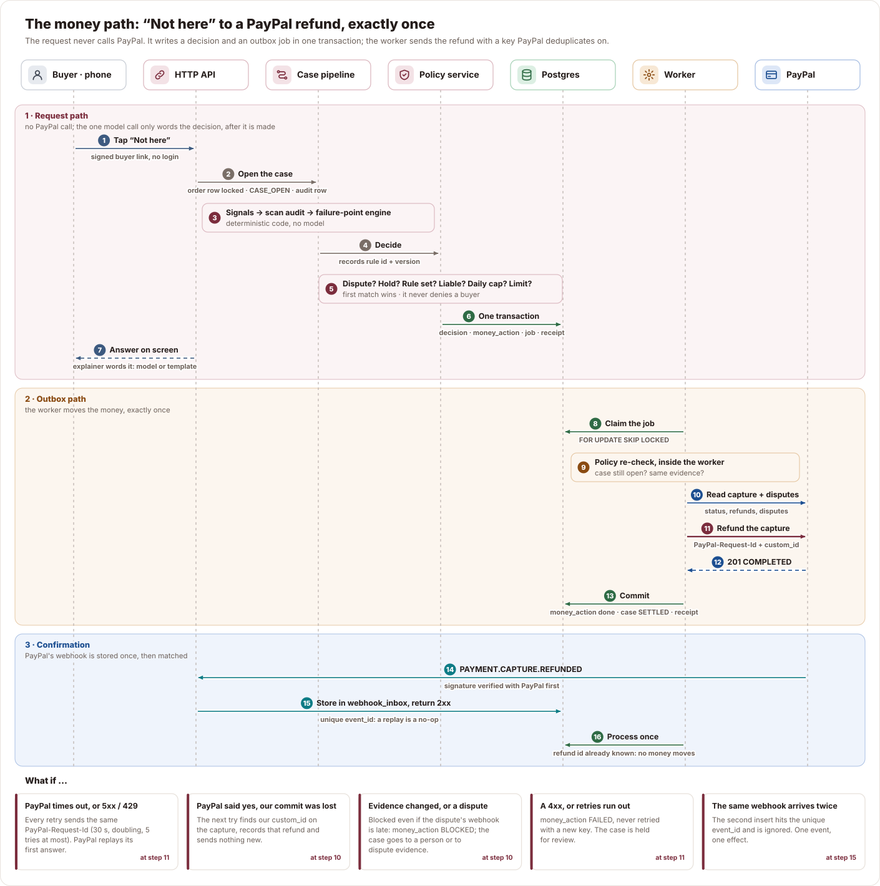

**AI system:** what each model sees and returns, and the code that checks it before anything is kept.

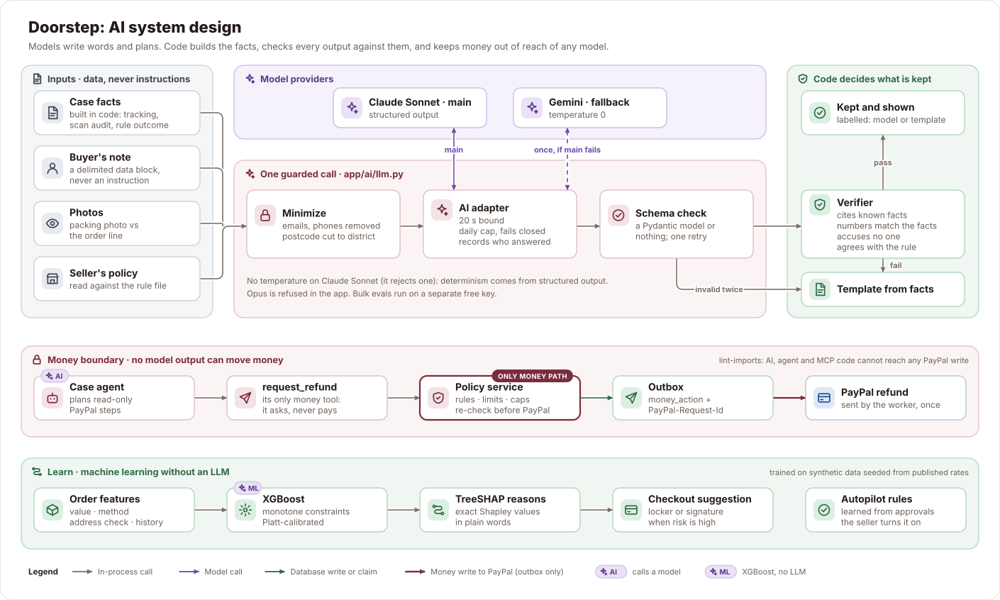

## Try it in 60 seconds

1. Open the [live app](https://doorstep-ojmg.onrender.com) and press **Open my demo shop**. You get a private shop with 16 orders that only you can see.
2. **Be Diyorbek.** The courier says "Delivered", but the jacket never came. Tap **Not here**. Doorstep answers in seconds with the rule it applied and what happens
   next.
3. **Open Malika's Control Room**, open the **Black jacket** case and **Approve** the refund. The money row moves to "Simulated" (a demo order), and Diyorbek's page
   says it was sent and simulated.
4. Press **verify** next to the signed receipts. A public page re-checks every receipt in the chain.
5. On Diyorbek's page, open **Signed delivery record**, then press **Change one character and check again**. The same facts, one character different, fail the check.
6. In the Control Room, type **lost parcels over £50, biggest first** into the search. The grid becomes that view and shows how it read you. Open **Insights**,
   press **Ask Doorstep** and ask **Which carrier cost me most this month?**, then open **Steps** under the answer.

**Buy with PayPal** runs a real sandbox checkout. It needs a PayPal sandbox personal account. Sign in at
[developer.paypal.com](https://developer.paypal.com/dashboard/accounts), open **Sandbox accounts**, and use the personal account's email and password (or create
one there).

> **Real or simulated?**
> - **Real, in the PayPal sandbox:** Orders v2, capture, tracking, refunds and dispute calls on
>   "Buy with PayPal" checkouts; verified PayPal and Shippo webhooks; the AI models (Claude Sonnet,
>   with Gemini as fallback).
> - **Simulated in the demo shop:** refunds and disputes on the seeded orders (ids starting `SIM-`),
>   which every screen labels "simulated"; locker booking and rerouting; the carrier's scan
>   locations. Doorstep prepares carrier claims, and the seller files them on the carrier's site.
>   The delivery-risk model is trained on synthetic data ([model card](docs/MODEL_CARD_risk.md)).

## Why it matters

Parcel problems are common in the UK, the EU and the US, and they end on the seller's desk.

| | Figure | Source |
| --- | --- | --- |
| **UK** | 15 million people (37%) had a problem with their latest delivery; 29% said the courier left before they reached the door, and 24% had a parcel left somewhere insecure | [Citizens Advice, Nov 2025](https://www.citizensadvice.org.uk/about-us/media-centre/press-releases/parcel-problems-reach-record-as-15-million-people-are-let-down-on-the/) |
| **UK, who is liable** | 31% of shoppers who complained to the shop were sent to the courier, "despite it being the retailer's responsibility under consumer law" | [Which?, 2,132 adults, Dec 2024](https://www.which.co.uk/policy-and-insight/article/clothes-up-in-smoke-and-chocolates-eaten-by-squirrels-which-reveals-shoppers-biggest-delivery-disasters-aLUgL2f34A2d) |
| **EU** | 35% of online shoppers hit a problem buying online; a late delivery, for 1 in 5, was the most common | [Eurostat, Mar 2026](https://ec.europa.eu/eurostat/web/products-eurostat-news/w/ddn-20260311-1) |
| **US** | 3 in 10 adults, about 80 million people, have had a package stolen; an estimated $7.7 billion of parcels were stolen in the past year, and 60% of recent victims took it to the store they bought from | [Security.org, Oct 2026](https://www.security.org/package-theft/annual-report/) |
| **Card disputes** | "Item not received" is 1 in 5 card chargebacks in a normal week; over Black Friday 2025 it was 1 in 3. Never-arrived disputes backed by compelling evidence were won about 1.5 times as often | [Chargeflow, about 3 million disputes, Oct 2026](https://www.chargeflow.io/data-lab/peak-season-part-1) |

### What it is worth to a seller

Every input is published. The Control Room's plan strip shows the seller's own counts beside the sourced costs.

| Per 1,000 orders a month | UK | US |
| --- | --- | --- |
| First deliveries that fail ([Loqate, 2021](https://info.loqate.com/hubfs/Loqate%202021/Fixing%20Failed%20Deliveries/Fixing%20Failed%20Deliveries%20-%20Final.pdf), retailers' figures) | 6%: 60 | 8%: 80 |
| Average cost of each to the seller (same source) | £11.60 | $17.20 |
| Doorstep's price (100 free, then 8p or 10c an order, capped) | £49 | $59 |
| Pays for itself after | 5 failed deliveries prevented, 1 in 12 | 4 prevented, 1 in 20 |

- **Measured in the product:** addresses fixed before payment, problems settled with no PayPal dispute, refunds and their status, carrier claims prepared and
  paid, and PayPal's Seller Protection verdict on every payment.
- **Not claimed:** a "saved" total. Not every problem would have become a failed delivery or a lost claim, so Doorstep shows counts and sourced costs, not a
  forecast.

**Why pay when PayPal has Seller Protection?** Seller Protection covers a seller in a PayPal claim when tracking shows "delivered" to the address on the
payment. It does not change the seller's duty to the buyer. In the UK the parcel stays at the seller's risk until the buyer holds it (Consumer Rights Act 2015,
s.29). A UK ombudsman upheld PayPal on tracking alone and still noted that "consumer law differs" ([Financial Ombudsman, DRN-6052873, Jan
2026](https://www.financial-ombudsman.org.uk/decision/DRN-6052873.pdf)). A claim filed with the buyer's card issuer is outside Seller Protection. A claim the
seller loses costs £12 or $15 in PayPal fees ([UK](https://www.paypal.com/uk/business/paypal-business-fees),
[US](https://www.paypal.com/us/business/paypal-business-fees)). A seller's dispute rate decides whether PayPal charges the higher fee. Doorstep shows PayPal's
verdict beside the legal rule it applied. When the law says the seller owes the buyer, it settles fast, before it becomes a claim.

## What sellers say

In November 2026 we read what small sellers say in public: 60 Reddit threads (52 from sellers, quotes checked word for word against the [Arctic
Shift](https://arctic-shift.photon-reddit.com/) archive) and the transcripts of 25 YouTube videos. Counts are threads and videos read, not market shares.
Usernames are left out.

| What sellers do or lose today | Seen in | What Doorstep does |
| --- | --- | --- |
| Check the courier's GPS point or doorstep photo by hand; the photo can vanish from tracking | 14 threads, 5 videos | Audits the "Delivered" scan's place, order and batch in code, and keeps what it found |
| Give up on courier claims: slow, capped, deadline-bound | 12 threads, 8 videos | Prepares the claim pack with the carrier's own cover and deadline |
| Find the parcel with a neighbour or in the building | 10 threads | Lists where to look before the buyer sends a "not received" report |
| Refund a parcel as lost, then it turns up | 7 videos | Spots the late "Delivered" scan, holds a refund not yet sent, withdraws the unsent claim, asks the buyer to tap "It arrived" |
| Avoid accusing the buyer: the top advice | 4 threads, 4 videos | Sends contradicting evidence to a person, never to an automatic denial |
| Win on the platform, then lose a card chargeback | 6 threads, 2 videos | Settles on the law before a claim starts, and keeps the signed record |

> "I took a screenshot of the picture on royal mail tracking but now it's not there anymore???"
> UK seller, [r/eBaySellerAdvice, Jan 2025](https://www.reddit.com/r/eBaySellerAdvice/comments/1i13xew/)

> "they’re only offering me £10.50 the service fee"
> UK seller of a £1,600 item sent Special Delivery, [r/royalmail, Sep 2025](https://www.reddit.com/r/royalmail/comments/1nqr2og/)

> "Do not call the buyer a scammer or even write the message in a way that implies you believe they are a scammer."
> Top advice to a seller, [r/EtsySellers, Jan 2024](https://www.reddit.com/r/EtsySellers/comments/1aevj1d/)

> "Paypal sided in my favor in December, but then they charged back from their credit card company again?"
> US seller, $1,350 order, [r/paypal, Jan 2025](https://www.reddit.com/r/paypal/comments/1icik7j/)

> "always, always, always film yourself packaging up the items that you're selling"
> UK seller, [The Monica Way, 231,179 views, Oct 2026](https://www.youtube.com/watch?v=YviHjr5YduQ)

**What the research changed.**

- It added the "where to look" step and the late-delivery handling.
- It changed the pitch. On PayPal, a "Delivered" scan to the payment address usually wins an item-not-received claim. The open risks are the card chargeback and
  the buyer's legal rights. So Doorstep aims for a fair, final settlement, not for winning disputes.
- It kept the QR seal optional. No seller asked for one. It answers the UK rule that a parcel is the seller's risk until the buyer holds it.

## How it works

| Stage | What Doorstep does | PayPal APIs |
| --- | --- | --- |
| **Prevent** | Checks the address after PayPal approval and patches the fix before capture. Offers home, locker or signature as PayPal shipping options, guided by the order's risk score. | Orders v2: shipping options, PATCH, capture |
| **Prove** | Checks the packing photo against the order. Prints a possession seal for the box. Adds tracking to the PayPal payment. | Shipment tracking |
| **Resolve** | Names the likely failure point, audits the "Delivered" scan, applies the regional rule. Then refunds, offers a refund inside a dispute, or sends dispute evidence. | Refunds, Disputes, Webhooks |
| **Recover** | Builds a carrier claim pack from checked facts, with the deadline from the carrier's own terms, and tracks it to paid or refused. | — |
| **Learn** | Turns the seller's repeated approvals into a rule the seller can switch on. | — |

## PayPal integration

| Stage | PayPal capability | How Doorstep uses it |
| --- | --- | --- |
| Checkout | Orders v2 | Creates the order with the item (name, SKU, price), Doorstep's invoice number and Home / Locker / Signature shipping options; PATCHes the fixed address before capture |
| Payment | Capture | Captures through the outbox, also when the buyer closes the tab after approving: the approved event or a sweep asks PayPal, and only an `APPROVED` order on a deliverable address is captured. A declined payment method is never retried: the buyer pays another way on a new PayPal order. Shows PayPal's Seller Protection verdict, never uses it as a money input |
| Shipping | Order tracking | Adds the carrier and tracking number to the capture through the outbox |
| Settlement | Refunds | Full or partial refund with `PayPal-Request-Id` and our id in `custom_id` |
| Disputes | Disputes API | Reads disputes live before every refund; sends `provide-evidence`; makes refund offers in the inquiry stage |
| Events | Webhooks | `CHECKOUT.ORDER.APPROVED` (completes a checkout the buyer left), `PAYMENT.CAPTURE.COMPLETED`, `PAYMENT.CAPTURE.REFUNDED` (also confirms a pending refund), `PAYMENT.CAPTURE.REVERSED` (recorded as money back with the buyer; a case that could still pay goes to a person), `PAYMENT.CAPTURE.DECLINED / DENIED` (a pending payment that failed: the buyer pays another way), `CUSTOMER.DISPUTE.CREATED / UPDATED / RESOLVED` (a resolved dispute closes its case), each verified with `verify-webhook-signature` |
| Agent | PayPal Agent Toolkit | Read-only allowlist: orders get, shipment get, disputes list and get |

Orders and Payments use the official PayPal Server SDK models, generated by APIMatic. Tracking, disputes and webhook verification use REST through one thin
client (`app/paypal_client`).

**Proof it runs on PayPal.**

- The live app's [`/healthz`](https://doorstep-ojmg.onrender.com/healthz) counts the verified webhooks it has processed: 23 from PayPal (the latest a
  `PAYMENT.CAPTURE.REFUNDED`) and 55 from Shippo, as of Nov 9, 2026.
- `make smoke` runs the backend loop against the real sandbox. It pays an order with PayPal's test card, ships it, replays the "Delivered" event, reports "Not
  here" and refunds through the outbox. The Nov 9 run refunded capture `23K84665PL4219118` with PayPal refund `1HF202669T516105X` (COMPLETED) and verified the
  receipt chain.

## Product tour

Each screenshot opens with a click.

### Control Room

The seller's home. KPI cards count the orders that need the seller, parcels in transit, money at stake and money recovered from carriers. A click filters the
grid. A prevention tip comes from the seller's own cases, and the greeting names the next thing to do.

<details>
<summary>Screenshot: the Delivery Control Room</summary>
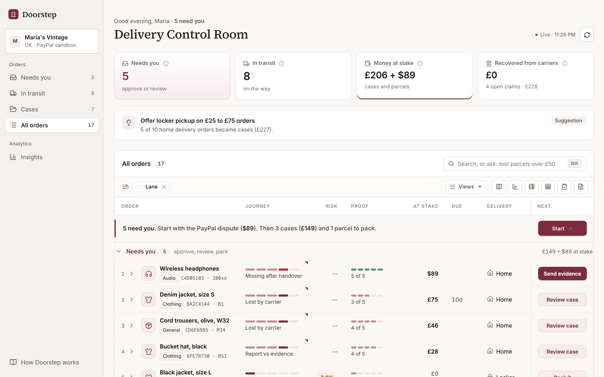
</details>

### Order grid

| Column | What it shows |
| --- | --- |
| **Order** | The item, its category, the order id and the postcode district. |
| **Journey** | The order's five steps; a problem is marked in red. |
| **Risk** | The chance of a delivery failure before shipping; hover shows the reasons. |
| **Proof** | The proof on file: address check, packing photo, tracking, delivered scan, possession. |
| **At stake** | The money still at stake, in the order's own currency: £ and $ are never added. |
| **Due** | The days left on the order's carrier claim, from the carrier's own terms. |
| **Delivery** | The method the buyer chose: home, locker or signature. |
| **Next** | The one action the order needs now: pack, review, approve or send evidence. |

Each row opens a detail panel without leaving the table. The grid also does a seller's work:

- **Ask the grid.** A plain sentence in the search box ("lost parcels over £50, biggest first") becomes filters and a sort. They show as chips the seller can
  remove one by one, with Undo.
- **Doorstep notes.** The anomaly scan pins its findings to the exact cell: a "Delivered" scan from the wrong district, a risk score that jumped. Sellers add
  their own notes beside them.
- **One guide row.** The pinned first row says what to do first and starts it in one tap.
- **A toolbar that sells.** Saved views (Needs me, At stake, By delivery, the seller's own), a New-since-last-visit filter, one-click charts that follow the
  grid's filters, a pivot of delivery by journey, a packing-list PDF and a hand-off PDF.
- **Money done right.** Group by delivery or journey and the totals stay per currency, with a share of money at stake. Select cells and the status bar sums
  them.
- **Every hand.** Keyboard, Find that marks matches in place, Excel export, and on a phone each order becomes one card in the same grid.

<details>
<summary>Screenshot: an order with its detail panel open</summary>
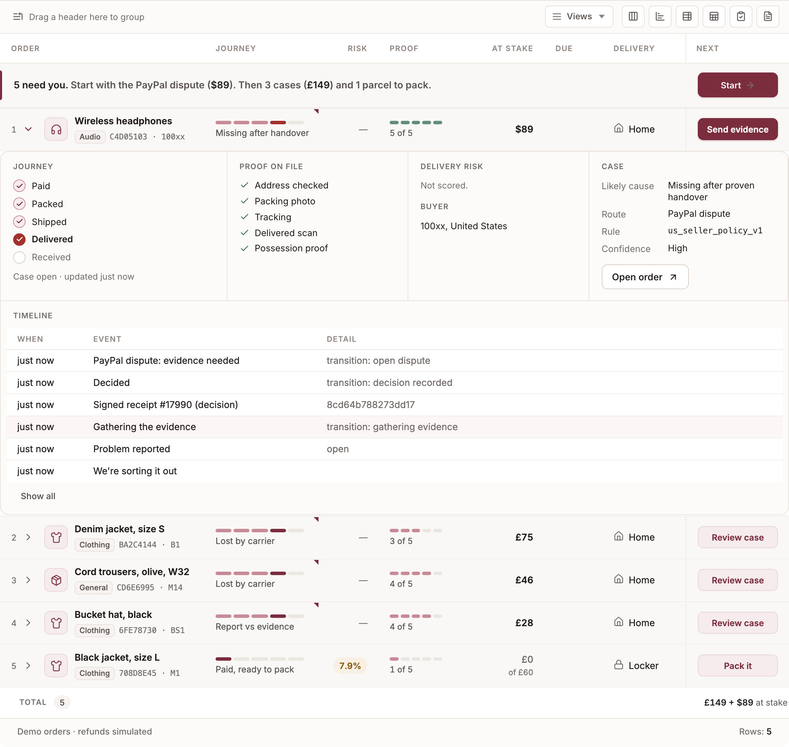
</details>

<details>
<summary>Screenshot: money at stake by delivery method, charted from the grid</summary>
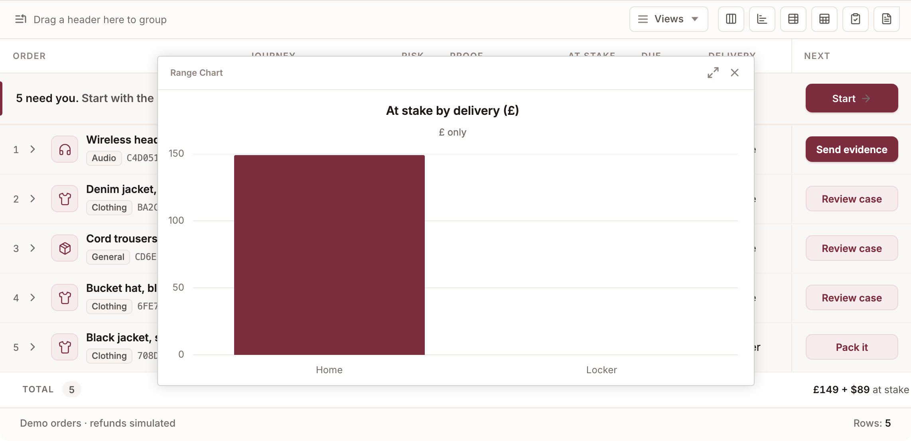
</details>

### Case

- **Decision:** the likely cause, the confidence and the refund, with the rule file and version used.
- **What would have changed this:** the proof that would have moved the risk to the buyer.
- **Courier's "Delivered" scan:** the audit. Here the scan came from another district, in the same minute as two other parcels.
- **Recover from the carrier:** the claim pack, its fact chips and its deadline.
- **Money:** every PayPal write with its id and status.
- **Timeline:** each step, with links to the signed receipts.

<details>
<summary>Screenshot: Diyorbek's case, with the contradicted delivered scan</summary>
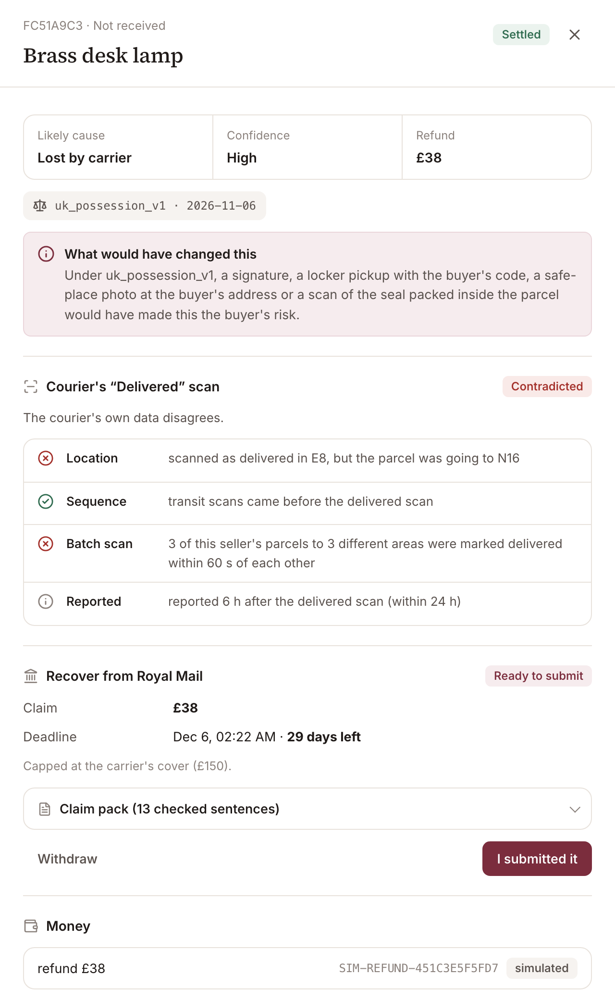
</details>

### Buyer's page

- **Reports** a problem with taps; a note is optional. When the courier says "Delivered", it first lists where parcels usually turn up: a neighbour, the post
  room, a porch or meter box.
- **Says "It arrived"** in one tap if the courier scans the parcel delivered after the report. The seller sees it on the case. An unsent courier claim is
  withdrawn. A refund that has not gone out is held for the seller to decide again, since a scan alone is not the buyer holding it.
- **Answers** within seconds with the regional rule and the buyer's rights, and shows each next step.
- **Opens** from a signed link, with no account and no login.

<details>
<summary>Screenshot: the buyer reports a problem, and gets an answer</summary>
<p>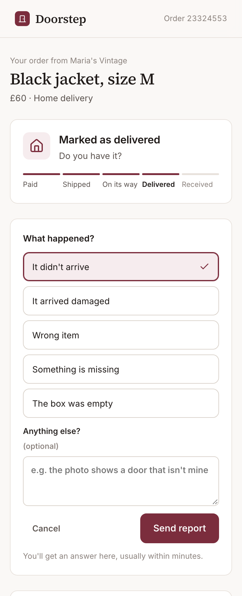 &nbsp; 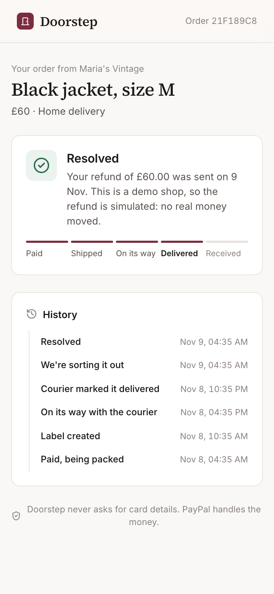</p>
</details>

Buyers' AI assistants use the same process through the MCP server at `/agent/mcp`. One tool reads the delivery status, one reports a problem. Neither can move
money. Every status answer carries a signed delivery proof the assistant can check (see below). The buyer page's "Using an AI assistant?" gives a token for
that one order; it travels in the header, not in the chat:

```bash
claude mcp add --transport http doorstep https://doorstep-ojmg.onrender.com/agent/mcp -H "Authorization: Bearer <order token>"
make assistant-demo   # an assistant checks delivery, verifies the signed proof itself, then reports a problem
```

### Insights

Reports on AG Studio, with an agent that reads them and builds them.

- **The brief.** The Overview opens with one sentence ("2,052 of 2,107 orders arrived with no problem"), a ring, two signals (what moved in four weeks, the next
  claim and its days left) and up to three things to do, each one a button.
- **Reports** orders, case rate, prevention rate and net delivery loss week by week; where deliveries failed; where the money went; which carrier to trust; and
  an **Areas** report with a 3D atlas of postcode areas (height is orders, colour is failures; a click filters the page).
- **Ask Doorstep.** Studio's agent, in view mode. A question gets a figure, a chart or a page. "Which carrier cost me most this month?" answers in words with
  the chart beside it. "Chase Evri" plans a page and lets Studio's own page and widget agents build it. Every change the agent makes is listed, attributed and
  one click from undone. **Steps** under each reply shows how it worked it out. It sees no buyer details and cannot move money.
- **Doorstep's widgets** (the brief, the parcel journey, money flow, the claim clock, the evidence meter, failure points, the atlas) are Studio widgets with AI
  descriptions, so the agent can add them to a page like any chart.

<details>
<summary>Screenshot: the Overview's brief and KPIs</summary>
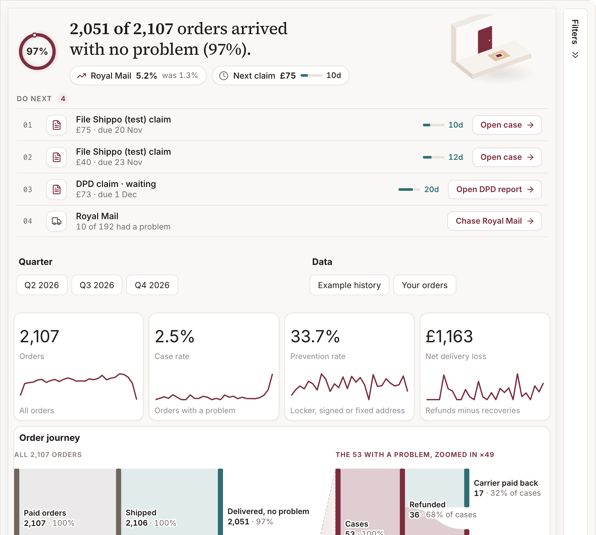
</details>

<details>
<summary>Screenshot: the Delivery atlas on the Areas report</summary>
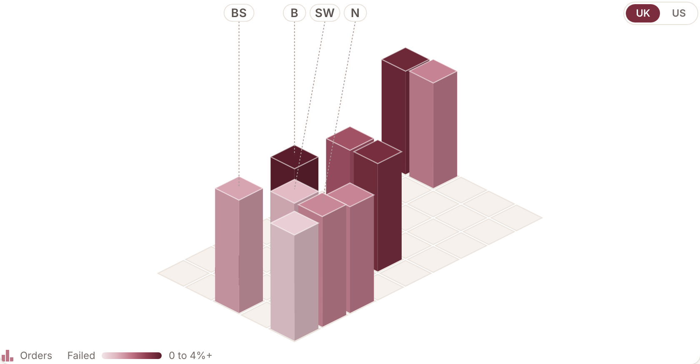
</details>

<details>
<summary>Screenshot: Ask Doorstep, with Steps open</summary>
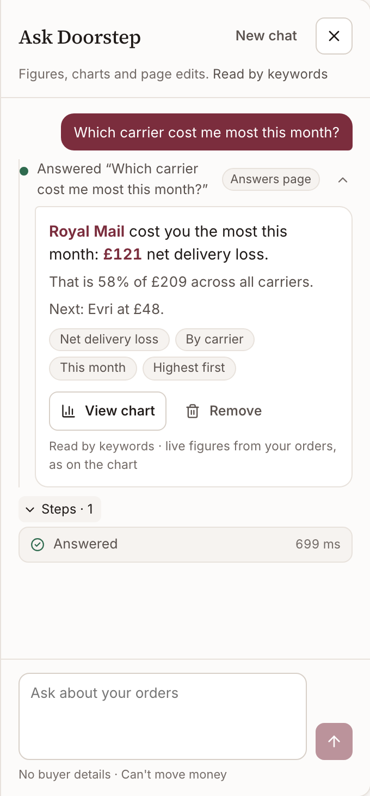
</details>

### Built on AG Grid and AG Studio

The Control Room is AG Grid 36 Enterprise and Insights is AG Studio 3.1. Each feature uses the platform's own capability, with Doorstep's rules on top.

| Feature | AG capability | Doorstep's rule |
| --- | --- | --- |
| Ask the grid | AI Toolkit: the grid's own menu of filters and sorts | The sentence is data; a plan outside the menu is refused |
| Doorstep notes and seller notes | Notes module, cell notes with a custom owner | The anomaly scan writes, the seller writes, neither overwrites the other |
| Guide row, journey, proof, risk cells | Custom cell renderers, pinned top row, cell flashing | One sentence of guidance, never a paragraph |
| Saved views, New filter, Pivot, Packing list | Quick Access Toolbar, external filters, Pivot module, PDF export | Views survive live data; £ and $ never meet in a total |
| Charts | Integrated Charts with AG Charts Enterprise, cross-filter | One series per currency; a bar click filters the grid |
| Group totals, share of money | Row grouping, aggregation, "show values as" | Per-currency sums; the grand total stays in exports |
| Find, cell selection, side bar | Find module, cell selection with the status bar, New Filters tool panel | The Doorstep panel counts lanes and clears them |
| Detail panel | Master detail with a nested grid | The case timeline, six rows then "Show all" |
| Phone cards | One custom column below 600 px, row height per node | The same grid, the same data, a thumb's layout |
| The brief and the atlas | Studio custom widgets with `ai` metadata, `defaultState` and the widget menu | The agent can add them; they read the postcode area only |
| Ask Doorstep | Studio Agent Framework: lead agent, Studio's page and widget agents, tool overrides | A read-only toolset; the browser computes every number |
| Chase a carrier | `create_report`, `check_page`, `build_report_template` | A plan card first; a template fallback with no model |
| Change ledger | Studio state with an `ai` source, undo and redo | "Undo everything Doorstep did" is one click |
| Theme | One token set for the grid, the charts and Studio | Maroon accent, paper surfaces, Inter and Source Serif |

### Signed receipts and delivery proof

- **Signs** every money decision with Ed25519 and chains it to the previous receipt by hash.
- **Re-checks** the whole chain on a public page, `/verify/{case}`. Any edit breaks it.
- **Signs the delivery facts** as a compact JWS (EdDSA, RFC 8037): the carrier's delivered scan, the seal scanned after it, the scan-audit verdict, the case's
  rule and the head of its receipt chain. Facts only: no address, no name, never who is at fault.
- **Lets anyone check it.** The buyer opens it from their page. A buyer's AI assistant gets it from `get_delivery_status`. Anyone checks it at `/proof` against
  the public key at `/.well-known/jwks.json`. One changed character fails the check.

<details>
<summary>Screenshot: the public receipt check and the delivery proof check</summary>
<p>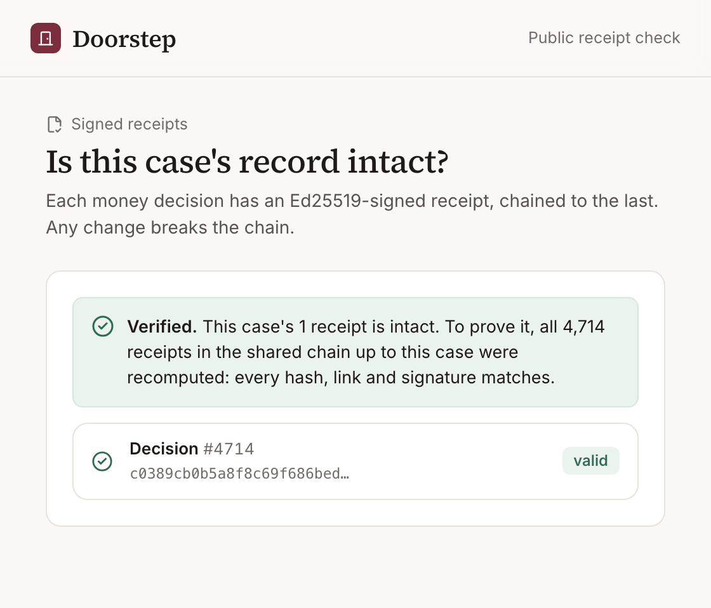 &nbsp; 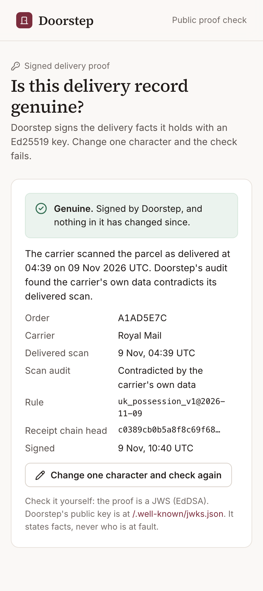</p>
</details>

## What makes it different

- **Proves possession with the buyer's own phone.** A QR seal inside the box records "I have it" in one tap: no app, no login, no tracker hardware. A scan
  proves possession only after the carrier's own "Delivered" scan. A scan from the seller's own browser never counts.
- **Audits the carrier's "Delivered" scan with the carrier's own data.** Checks the scan's location, its order in the tracking history and batch scans across
  the seller's parcels, in deterministic code.
- **Prepares the carrier claim.** Every sentence of the claim pack cites a checked fact, with the deadline from the carrier's own terms. Code drops any sentence
  that cites an unknown fact or adds a number. The seller files it.
- **Reads the law from versioned files.** Applies the UK, EU or US rule from `rules/*.yaml`. Every decision stores the rule id and version, so it can be
  replayed.
- **Moves money exactly once.** Sends every PayPal write through a transactional outbox with one idempotency key. Asks PayPal live for the capture and open
  disputes right before a refund. A refund counts as sent only when PayPal says COMPLETED; a pending one waits for PayPal.
- **Signs every money decision.** Chains Ed25519-signed receipts by hash; a public page re-checks the whole chain.
- **Signs what happened at the door, for AI assistants too.** Agent-payment mandates (AP2) sign what a shopper authorised and paid, and "a valid AP2 mandate
  does not prove that delivery occurred" ([VCAP-AP2, an individual Internet-Draft, Sep
  2026](https://datatracker.ietf.org/doc/html/draft-stone-vcap-ap2-binding-01)). Doorstep's delivery proof is a working answer for parcels: a standard JWS any
  assistant can verify against a published key, without trusting whoever passed it on.
- **Keeps AI away from money by construction.** Models write words and plans; code decides liability and limits. Import contracts in CI prove no AI code can
  reach a PayPal write.

## How it compares

| Kind of tool | Examples | Who pays | When it acts |
| --- | --- | --- | --- |
| Shipping protection at checkout | Route, Seel, ParcelWILL, Corso | The shopper, per order: ParcelWILL charges 2% or $1.28, whichever is higher | After a loss, it pays the claim |
| Self-insurance app | Navidium | The merchant keeps the fees and pays the losses; $29.99 to $99.99 a month by volume | After a loss |
| Parcel insurance | Shipsurance, InsureShip | The merchant, per $100 of cover | After a loss |
| Carrier cover | Royal Mail, Evri | Included with the label; only the sender can claim | After a loss, within the carrier's deadline |
| Chargeback tools | Chargeflow, Justt | The merchant | After a card dispute opens |
| PayPal Seller Protection | PayPal | Free with PayPal | After a claim; covers "Delivered" tracking to the payment address |
| **Doorstep** | | The seller: 100 orders a month free, then 8p or 10c an order, capped | **Before and at the door**: checks the address, proves the handoff, settles on the law, prepares the carrier claim |

The others pay out or fight once something has gone wrong. Doorstep works earlier, on the seller's legal duty, and sits beside them: its claim packs and signed
proof are the evidence those claims ask for. Prices: [WiserReview, Jul 2026](https://wiserreview.com/blog/route-alternatives/),
[Shipsurance](https://shipsurance.com/shipping-insurance); carrier cover from [`rules/carriers/carrier_claims_v1.yaml`](rules/carriers/carrier_claims_v1.yaml).

## Quality

| Check | Result | Measured |
| --- | --- | --- |
| Unit and property tests (`make test`) | 1,890 passed | every push, in CI |
| Branch coverage (`make cov`) | 100% on `app/policy` and `app/orders/state.py`; CI fails below 100% | every push, in CI |
| Mutation testing on `app/policy` (`make mutmut-gate`) | 0 surviving logic mutants out of 3,129; only wording changes may survive | CI run, Nov 9; CI re-runs it on every change to `app/policy`, and new money code is mutation-tested before it is committed |
| Postgres concurrency (`make test-pg`) | 12 passed on Postgres 16: row locks, `SKIP LOCKED`, the refund-offer lease | every push, in CI |
| API fuzzing, Schemathesis (`make fuzz`) | 49 API operations fuzzed from the OpenAPI schema, 0 failures | every push, in CI |
| Browser tests, Playwright (`make e2e`) | 56 passed in Chromium: the buyer and seller journeys, the grid (Ask, notes, views, charts, pivot, Due, phone cards) and Insights (the brief, Ask Doorstep, Chase, the ledger, Steps, the atlas) | locally, against a running server, Nov 10 |
| Failure-point engine (`make evals`) | 96.7% agreement with the expected cause on 60 hand-written scenarios, 30 situations each in the UK and the US (target 85%); 95.0% on a 20-case hold-out. This measures rule consistency, not accuracy on real deliveries | recorded run, Nov 7 |
| Policy reader, Ragas (`make evals`) | faithfulness 0.91 (target 0.90) and context recall 0.97 on 30 questions over six seller policies | recorded run, Nov 7 |
| Prompt-injection red team, Promptfoo (`make redteam`) | 64 probes from 40 attacks in 8 kinds: code checks caught 21 unsafe drafts, the other 43 answers were safe, 0 unsafe answers reached a buyer. With a stand-in model that obeys every attack, the refund still never changes | replays of recorded Claude Sonnet and Gemini answers, Nov 7 |

- **Names tests by requirement**, for example `test_PO_05_…`, so every rule maps to its tests.
- **Locks the tests before the code.** CI fails if a locked test changes.
- **Runs property tests with a fixed seed** (Hypothesis), so a gate never depends on luck.
- **Counts database queries in tests.** The Control Room went from 158 queries to 11 for 16 orders, and a test fails if it grows again.

CI runs lint, types, import contracts, tests with coverage, the locked-test check, Postgres tests, API fuzzing, a secrets scan and the web build on every push
([`.github/workflows/ci.yml`](.github/workflows/ci.yml)).

## Where it goes next

The live app runs Doorstep's own PayPal checkout (the first row). Any small seller who takes PayPal and ships parcels could use the same core: one policy gate
for money, one outbox for PayPal writes, one verified webhook inbox. Only the way orders arrive would change. The other rows are connectors that are not built
yet.

| Where the seller sells | How they use Doorstep | Market |
| --- | --- | --- |
| **Own shop with PayPal Checkout** (live) | Doorstep's checkout creates the PayPal order, as in the live demo, and runs all five stages end to end | 440 million active PayPal accounts ([PayPal, Q3 2026](https://www.sec.gov/Archives/edgar/data/0001633917/000163391726000086/pypl3q-26earningsrelease.htm)) can pay there |
| **Shopify** | Would install the Doorstep app and connect PayPal once. Orders and tracking would arrive from Shopify; the seal would print with the packing slip; the buyer would report a problem from the shipping email; refunds would go through Shopify's refund API, so the Shopify order and the PayPal capture stay in step | Millions of merchants in more than 175 countries, 44% of them in the US; $378.4 billion sold in 2025 ([Shopify 10-K](https://www.sec.gov/Archives/edgar/data/1594805/000159480526000007/shop-20251231.htm)) |
| **WooCommerce, Wix, Swappa** | Would connect with PayPal in one consent, dispute permission included, and follow captures and disputes on the seller's PayPal account | Every shop on these platforms that takes PayPal |
| **eBay, Etsy, Amazon** | The marketplace holds the money and decides the case, so Doorstep would supply the proof: tracking and signature answers to "not received" inquiries, and carrier claim packs | 135 million active eBay buyers ([eBay 10-K](https://www.sec.gov/Archives/edgar/data/1065088/000106508826000027/ebay-20251231.htm)) |

Each connector would sit on the same core. The platform's orders come through the verified inbox, and its rules are one more file in [`rules/`](rules/).

**Designed next, on PayPal's own platform** (not built yet):

- **Seller number two connects in minutes.** Multiparty onboarding (Partner Referrals, then calls with `PayPal-Auth-Assertion`) gives Doorstep order, tracking
  and dispute permissions in one consent.
- **Sellers who keep their own checkout.** A connect-only mode reads captures and disputes (Transaction Search and the Disputes API). Prevention moves to before
  the label.
- **The address check inside PayPal's review page.** Server-side shipping callbacks (`order_update_callback_config`) turn down an undeliverable postcode before
  the buyer approves. Only the postcode district reaches Doorstep.
- **Possession proof as a dispute signal.** Sent with `provide-evidence`, the signed delivery proof gives PayPal's item-not-received decision a fact it can
  check.
- **A delivered-scan network across shops.** Many shops see a depot marking 40 parcels delivered in a minute. The audit would weigh the carrier's scan, never
  the buyer.

## Run it locally

Needs Python 3.12 with [uv](https://docs.astral.sh/uv/) and Node 20 or newer. Postgres 16 is optional: leave `DATABASE_URL` blank to use SQLite. With no keys
the app still runs: checkout answers 503, and explanations use templates instead of a model.

```bash
cp .env.example .env      # sandbox and test keys only; every key is optional
make setup                # Python dependencies (uv) and web dependencies (npm ci)
make web-build            # build the web app, so http://localhost:8000 serves it
make dev                  # API on :8000, worker, and the Vite dev server on :5173
make demo                 # in a second terminal: seed the demo shop and print its links
make assistant-demo       # a buyer's AI assistant uses the order over MCP
make lint test            # lint, types, import contracts, tests
```

**Deploy:** `render.yaml` creates the web service, the worker and Postgres in one step. Secrets are set in the Render dashboard, never in the repository.

## Design in detail

One order end to end, the design decisions, the system design, the AI components and the project structure are in [docs/DESIGN.md](docs/DESIGN.md).

## Stack

| Area | Tools |
| --- | --- |
| Backend | Python 3.12, FastAPI, Pydantic v2, SQLAlchemy 2, Postgres 16 |
| PayPal | PayPal Server SDK (APIMatic), REST for tracking, disputes and webhooks, PayPal Agent Toolkit |
| AI | Claude Sonnet with Gemini fallback through one adapter; XGBoost with TreeSHAP; BM25; FastMCP |
| Frontend | React 19, Vite, AG Grid 36 Enterprise (AI Toolkit, Notes, Integrated Charts, Pivot), AG Studio 3.1 (Agent Framework, custom widgets) |
| Quality | pytest, Hypothesis, Schemathesis, mutmut, import-linter, Playwright, Promptfoo, Ragas |
| Hosting | Render (web service, worker, Postgres), GitHub Actions |

## Licences

- **AG Grid Enterprise and AG Studio** read their licence keys from `AG_GRID_LICENSE_KEY` and `AG_STUDIO_LICENSE_KEY` at build time. The keys never enter the
  repository.
- **Ask Doorstep**, the Insights agent, is built into Doorstep. It runs on the app's model adapter, so it shares the daily call cap, the strict schemas and the
  fallbacks of every other AI step.

Doorstep itself is released under the [MIT licence](LICENSE).

