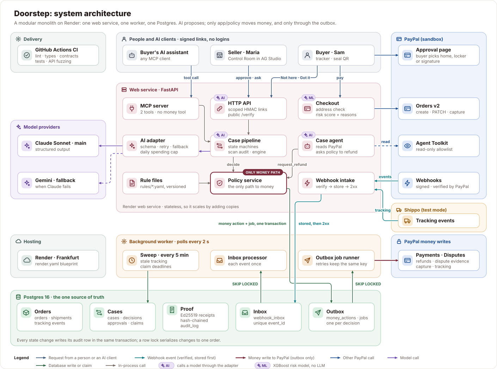
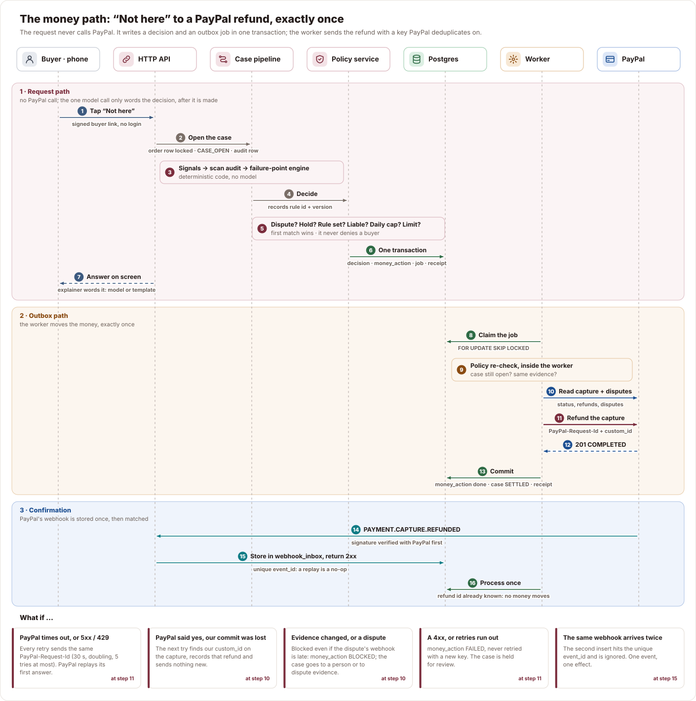
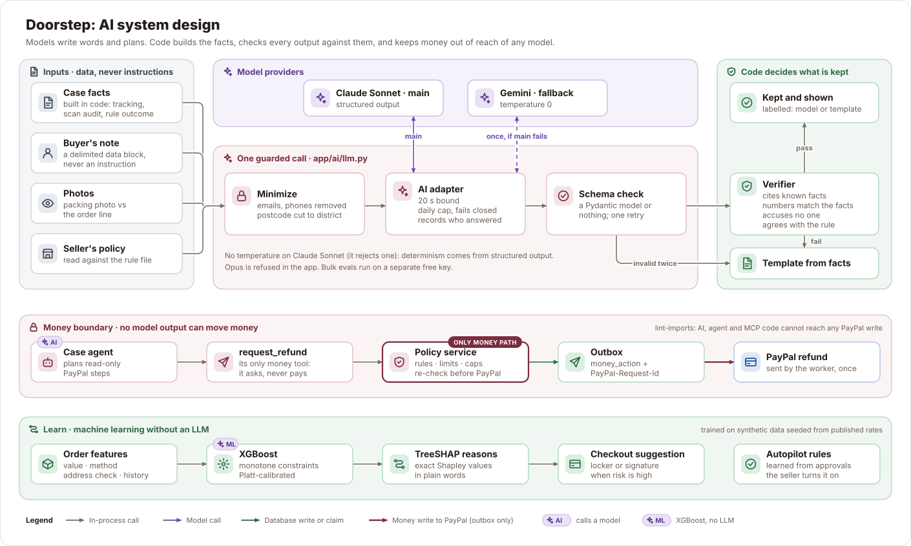

# Doorstep system design

How Doorstep is built, why each part looks the way it does, and what changes as it grows.
This page follows the usual order for a system design review: requirements, estimates, interfaces,
the high-level design, deep dives, the AI and ML design, failure modes, then scale. Every claim is
checked against the code, and anything not built is listed in [Honest limits](#11-honest-limits).

**In one paragraph.** Doorstep is a modular monolith on Render: one FastAPI web service, one
background worker, one Postgres. People reach it through signed links, AI shopping agents reach it
through MCP, and PayPal and Shippo reach it through verified webhooks. Every webhook is stored
before anything acts on it (inbox), and every PayPal write is stored before it is sent (outbox).
Models write words and plans; deterministic code decides who is liable, and only `app/policy` can
move money. Each money decision gets a signed receipt that anyone can verify.

## Contents

1. [Requirements](#1-requirements)
2. [Back-of-the-envelope estimates](#2-back-of-the-envelope-estimates)
3. [API](#3-api)
4. [Data model](#4-data-model)
5. [High-level design](#5-high-level-design)
6. [Deep dives: the decisions that matter](#6-deep-dives-the-decisions-that-matter)
7. [AI system design](#7-ai-system-design)
8. [ML system design: the risk model](#8-ml-system-design-the-risk-model)
9. [What if…: failure modes](#9-what-if-failure-modes)
10. [Scale path](#10-scale-path)
11. [Honest limits](#11-honest-limits)
12. [What we took from each reference](#12-what-we-took-from-each-reference)

## 1. Requirements

**Functional** (full list with test ids: [specs/ACCEPTANCE.md](../specs/ACCEPTANCE.md)):

| Stage | The system must… |
| --- | --- |
| Prevent | fix a missing flat number before capture; offer home, locker or signature as PayPal shipping options; score each order's risk with reasons |
| Prove | check the packing photo against the order; add tracking to the PayPal capture; record the buyer's seal scan as possession proof |
| Resolve | open a case on "Not here", name the likely failure point, apply the regional rule, refund through PayPal or send dispute evidence |
| Recover | build a carrier claim pack from verified facts and track it to paid or refused |
| Learn | turn the seller's repeated approvals into rules the seller can switch on |

**Non-functional**, in priority order:

| Property | Target | How it is met |
| --- | --- | --- |
| Money safety | zero double refunds; never refund more than was captured | outbox, PayPal-Request-Id, unique constraints, pre-refund re-check ([§6.1](#61-exactly-once-refunds-without-a-distributed-transaction)) |
| Fairness | never accuse or deny a buyer automatically | contradictions and repeat claims go to a person; an accusation filter on model text |
| No lost events | every PayPal and Shippo event is processed exactly once | verify, store, then 2xx ([§6.2](#62-webhooks-verify-store-acknowledge)) |
| Explainability | every decision names its rule id and version and can be replayed from its stored signals (engine version not yet stored: review R9) | rules as versioned data ([§6.8](#68-rules-are-data-not-code)) |
| Tamper evidence | anyone can check a money decision was not edited later | Ed25519-signed, hash-chained receipts ([§6.6](#66-signed-receipts-a-tamper-evident-log)) |
| Privacy | models see the postcode district, never the address | redaction in the one AI adapter ([§7](#7-ai-system-design)) |
| Cost | the paid model cannot run up a bill | daily call cap shared by both processes, fails closed ([§6.7](#67-model-spending-cap)) |
| Latency | "Not here" to a decision in under 2 minutes (spec target) | the decision is made in the request; only the refund waits for the worker |

**Out of scope:** live carrier rerouting, real locker booking, filing claims on carrier portals,
cross-border duties, live PayPal keys.

## 2. Back-of-the-envelope estimates

The hackathon runs one instance of each service. These numbers ask what the design has to survive
if it works: **10,000 sellers at 1,000 orders a month** (the top of the 100–5,000 target band is
5,000). Seconds in a month: about 2.6 million.

| Quantity | Assumption | Per month | Average per second | Peak (×5) |
| --- | --- | --- | --- | --- |
| Orders | 10,000 × 1,000 | 10 M | 3.9 | ~20 |
| Tracking events (webhooks) | ~6 per order | 60 M | 23 | ~115 |
| Cases | 1–2% of orders ([SPEC §14](SPEC.md)) | 100–200 k | 0.04–0.08 | < 1 |
| Refunds and evidence (PayPal writes) | ≤ 1 per case | ≤ 200 k | < 0.1 | < 1 |
| Model calls | ≤ 10 per case, plus checkout and packing checks | ≤ 2 M+ | ~1 | ~5 |

| Storage | Assumption | Per month |
| --- | --- | --- |
| `tracking_events` | 60 M rows × ~1.5 KB raw JSON | ~90 GB |
| `webhook_inbox` | one row per event, similar size | ~90 GB, prunable once processed |
| Everything else | orders, cases, receipts, audit rows | a few GB |

**What the numbers say.** The money path is tiny: under one refund a second even at this scale, so
correctness matters far more than throughput there, and serializing receipt appends is affordable
([§6.6](#66-signed-receipts-a-tamper-evident-log)). The hot path is **tracking webhooks**
(~115/s at peak): that is why intake only verifies, stores and returns, and why the two event tables
are the first to partition ([§10](#10-scale-path)). Photos are not in this table; at this scale they
belong in object storage with the 90-day deletion rule.

## 3. API

The full contract is FastAPI's OpenAPI schema, which Schemathesis fuzzes in CI.
There are no accounts: each caller gets a link whose HMAC token is scoped to one order or one seller
and expires ([§6.5](#65-signed-links-instead-of-accounts)).

| Caller | Endpoint | Purpose |
| --- | --- | --- |
| Buyer (checkout) | `POST /api/checkout/quote` · `start` · `return` | quote delivery options, create the PayPal order, return after approval |
| Buyer (link) | `GET /api/buyer/{token}` | tracker: status, choices, rights card |
| Buyer (link) | `POST /api/buyer/{token}/address` · `keep-address` · `choice` | fix the address before capture; answer a delivery choice |
| Buyer (link) | `POST /api/buyer/{token}/got-it` · `not-here` | confirm possession, or open a case |
| Buyer (seal QR) | `GET /api/seal/{token}` · `POST …/confirm` · `…/report` | "I have it" or "Something's wrong" from inside the parcel |
| Seller (link) | `GET /api/seller/{token}/orders` · `cases/{id}` · `recoveries` · `insights` | the Control Room's data |
| Seller (link) | `POST /api/seller/{token}/cases/{id}/{action}` | approve, decline, reship, send dispute evidence |
| Seller (link) | `POST …/orders/{id}/packing-check` · `ship` | packing photo check; buy the label and add tracking |
| Seller (link) | `POST …/agent/cases/{id}` · `insights/ask` | the case agent's pre-check; Ask Doorstep |
| AI agent (MCP) | tools `report_delivery_problem`, `get_delivery_status`, with a scoped token | the same fair process for a buyer's AI; no money tool |
| Anyone | `GET /cases/{id}/verify` | re-check a case's signed receipt chain |
| PayPal | `POST /webhooks/paypal` | signature verified with PayPal, then stored |
| Shippo | `POST /webhooks/shippo/{token}` | secret URL token compared in constant time, then stored |
| Render | `GET /healthz` | health, and which parts are simulated |

Status codes are part of the design: a webhook gets **2xx only after it is stored**, **503** when
PayPal's verification endpoint is down (so PayPal retries), and **404** for a wrong Shippo token
(nothing to learn for a prober).

## 4. Data model

One Postgres database is the source of truth. Constraints do the work that would otherwise need
coordination:

| Group | Tables | The constraint that matters |
| --- | --- | --- |
| Orders | `orders`, `shipments`, `tracking_events` | an order's state changes only through `app/orders/state.py`, under a row lock |
| Cases | `cases`, `decisions`, `approvals`, `recoveries`, `disputes` | at most one open case per order; `paypal_dispute_id` unique |
| Money | `money_actions`, `jobs` | **unique (decision_id, kind)**: one refund per decision, ever |
| Events | `webhook_inbox` | **unique event_id**: a replayed webhook is a no-op |
| Proof | `receipts`, `audit_log` | receipts form one chain by unique `seq`; audit rows are append-only |
| Cost | `model_usage` | one row per (UTC day, provider), incremented under a row lock |

All money is integer minor units plus an ISO 4217 code (GBP or USD), never floats.

## 5. High-level design

The system has three moving parts and two queues.

- **Web service (stateless).** Serves the React app and the API. A request only touches Postgres
  (and, for "Not here", one bounded model call that words the decision after it is made). It never
  sends money. Its only synchronous PayPal writes are checkout's order create and address PATCH,
  because the buyer is waiting on PayPal's page; capture, tracking, refunds and dispute evidence
  all go through the outbox.
- **Worker.** Polls every 2 s. Claims inbox rows and jobs with `FOR UPDATE SKIP LOCKED`, so two
  workers never take the same row. Runs the 5-minute sweep: stale tracking, claim deadlines.
- **Postgres.** Holds the business rows *and* both queues, so a state change and the work it causes
  commit in one transaction.

**One case, end to end**, as a numbered sequence (steps 1–7 in the request; 8–13 in the worker;
14–16 when PayPal confirms):

## 6. Deep dives: the decisions that matter

Each decision below lists the options weighed, the choice, and its cost. Full records are in
[DECISIONS.md](DECISIONS.md) (ADR numbers in brackets).

### 6.1 Exactly-once refunds without a distributed transaction

The core problem of any payment system: a network call to PayPal can succeed while our commit
fails, or fail after PayPal acted. Exactly-once delivery over a network does not exist; exactly-once
*effect* does, as **at-least-once retries plus idempotency**.

| Option | Verdict |
| --- | --- |
| Call PayPal inside the request | Rejected. A timeout leaves you not knowing whether money moved, and the buyer waits on PayPal. |
| Two-phase commit across Doorstep and PayPal | Impossible. PayPal is not a participant in our transaction. |
| **Transactional outbox + idempotency key + reconciliation** | **Chosen.** |

How it works:

1. The policy decision, the `money_action`, its `jobs` row and the receipt commit in **one
   transaction**. Either all exist or none do.
2. `money_action` is unique on (decision_id, kind), so a double-tapped Approve or a replayed request
   cannot create a second refund row.
3. The worker sends the refund with `PayPal-Request-Id = money_action.request_id`. Every retry
   reuses it, so PayPal returns the first result instead of refunding again.
4. Right before sending, the policy **re-checks** live state: the case is still open, the evidence
   fingerprint is unchanged, the live capture (read from PayPal) still has room for this amount
   [ADR-016], and PayPal itself shows no unresolved dispute on the capture. The dispute check asks
   PayPal directly, so a late webhook cannot hide one, and a failed read sends nothing
   ([review R1](ARCHITECTURE_REVIEW.md#r1--a-refund-can-go-out-while-a-paypal-dispute-is-open)).
5. Our `money_action.id` travels as PayPal's `custom_id`. If PayPal said yes but our commit was lost,
   the next attempt finds that refund on the capture, records it and sends nothing [ADR-022].
6. Retries: 5xx, timeouts and 429 back off from 30 s, doubling, up to 5 attempts [ADR-034]. Any
   other 4xx is permanent: the money action is marked failed, never retried with a new key, and the
   case goes to a person [ADR-021].

Property tests (Hypothesis) run random sequences of operations and check the invariants: refunds
never exceed the capture, nothing is refunded before it is paid, and no case settles without a
recorded decision and approval.

### 6.2 Webhooks: verify, store, acknowledge

| Option | Verdict |
| --- | --- |
| Process the event inside the webhook request | Rejected. Slow work risks PayPal's timeout and retries, and a crash mid-way loses the event. |
| Return 2xx first, then store | Rejected. A crash between the two loses the event for good. |
| **Verify → insert into `webhook_inbox` → 2xx; the worker processes later** | **Chosen** (the inbox pattern). |

The unique `event_id` turns PayPal's at-least-once delivery into one effect. Forged events fail
verification and are never stored. Events for unknown orders are logged and skipped, never failed,
so they cannot jam the queue.

### 6.3 Postgres as the queue

| Option | Verdict |
| --- | --- |
| Redis, RabbitMQ or SQS | Rejected for now. Another system to run, and enqueueing could no longer share a transaction with the business row: the dual-write problem the outbox exists to avoid. |
| **A `jobs` table claimed with `FOR UPDATE SKIP LOCKED`** | **Chosen.** One system, transactional enqueue, safe parallel workers. |

A job runs inside the transaction that claimed it, so a crash rolls everything back and the row is
claimed again; the idempotency key makes that second attempt safe. The price is a transaction held
open during the PayPal call, bounded by the HTTP timeout. Other costs: up to 2 s of polling delay,
and Postgres becomes the queue's ceiling. At the estimated peak
(~115 events/s) that ceiling is far away. Failed jobs stay in the table with their error, which
works as a dead-letter queue, and jobs whose rows vanished are failed on purpose [ADR-021].

### 6.4 Concurrency: pessimistic locks plus unique constraints

Two writers can race on one order: a carrier event and a "Not here" tap, or two Approve taps.

| Option | Verdict |
| --- | --- |
| Optimistic locking (version column, retry on conflict) | Good when conflicts are rare and retries are cheap. Here a lost race can mean money, and retry logic in every caller is easy to get wrong. |
| **`SELECT … FOR UPDATE` on the order (and case, money action, usage row)** | **Chosen.** Contention is per order, so locks are short and rarely contended. |
| Unique constraints | Kept as the last line of defense: even with a bug above, the database refuses a second refund row or a second event. |

Every state transition writes its audit row in the same transaction, and the transition tables in
[SPEC §8](SPEC.md) are the only legal moves; anything else raises. Repeat carrier events are logged
no-ops; out-of-order ones are recorded without a transition. The property tests in
[§6.1](#61-exactly-once-refunds-without-a-distributed-transaction) drive random operation sequences
through these state machines.

### 6.5 Signed links instead of accounts

Buyers will not create an account to report a missing parcel, and the spec allows zero typing.

| Option | Verdict |
| --- | --- |
| Accounts and passwords | Rejected. Friction exactly where the buyer is already upset. |
| Server-side sessions | Rejected. State in the web tier, which breaks "add copies to scale". |
| **HMAC-signed tokens: base64url(claims).base64url(mac), with a scope and an expiry** | **Chosen.** Stateless, so any web instance can check them. |

Scopes are narrow (buyer, seller, seal, MCP), each token names one order or one seller, and buyer
links last 30 days. Cost: a leaked link works until it expires, and revoking one means rotating the
key. A scan from the seller's own browser carries the seller cookie and never counts as the buyer's
possession proof.

### 6.6 Signed receipts: a tamper-evident log

| Option | Verdict |
| --- | --- |
| A plain audit table | Not enough on its own: anyone with database access can edit history silently. |
| A blockchain | Rejected. Consensus solves a trust problem one company does not have. |
| **An append-only hash chain, each entry signed with Ed25519** | **Chosen.** The idea behind Certificate Transparency logs, kept linear because one service writes it. |

Each receipt stores `sha256(seq, kind, case_id, payload, prev_hash, at)` and a signature of that
hash. Editing any stored receipt breaks verification at that receipt. `GET /cases/{id}/verify` is
public, so payloads hold ids, amounts and rule ids only. The chain is global, so appends wait for
each other [ADR-040]. At under one money decision a second that is fine; [§10](#10-scale-path)
says what changes at scale.

### 6.7 Model spending cap

The paid model has a small prepaid budget, and judges can use the live app until results are out.

| Option | Verdict |
| --- | --- |
| A counter in memory | Rejected. The web service and the worker are separate processes: each would get its own cap. |
| **A fixed-window counter in Postgres: one row per (UTC day, provider), incremented under a row lock** | **Chosen.** |

It works like the fixed-window rate limiter from the system design literature, applied to spend.
Past the cap (default 400 calls a day, `LLM_DAILY_CALL_LIMIT`), the paid provider counts as down and
the adapter falls back to Gemini, then to templates. If the count cannot be read, the paid call is
not made: a cost cap fails closed.

### 6.8 Rules are data, not code

Liability rules live in `rules/*.yaml` with an `id`, a `version` and a `source` (for example,
Consumer Rights Act 2015 s.29). Files are validated at startup and an invalid file stops startup.
Every decision stores the rule id and version, so a past decision can be replayed exactly. Changing
a rule needs a pull request; nothing edits rules at runtime, and no model can change or skip one.

## 7. AI system design

**Framing.** Doorstep is a *workflow with AI steps*, not a free-roaming agent: a coded state machine
decides what happens next, and each AI step has one narrow job with a schema. This follows the
common advice to prefer simple, composable workflows and give a model autonomy only where it pays
off ([Anthropic, Building effective agents](https://www.anthropic.com/engineering/building-effective-agents)).
Where Doorstep does use an agent (the case agent), its tools are read-only plus one tool that
*asks* the policy for a refund.

### 7.1 The components

| Component | Job | Model | Output (validated) | Checked in code by | Fallback |
| --- | --- | --- | --- | --- | --- |
| Packing check | Does the photo match the order line? | Vision (main provider) | match, item, colour, size seen, reasons, confidence | below a confidence floor it is "check", never a pass | "Please check" |
| Explainer | Word the decision for buyer and seller | LLM | summary, buyer message | must agree with the rule outcome; no accusation | template from the decision |
| Claim pack drafter | Write the carrier claim | LLM | sentences, each citing fact ids | unknown fact id or a number not in its facts → sentence dropped | template built only from facts |
| Case agent planner | Choose the next read-only step | LLM | one tool name + reason | tool allowlist; `request_refund` goes to the policy | fixed plan, labelled as such |
| Policy check | Find misleading lines in the seller's policy | LLM | issues with quotes and fact ids | quote must be word for word; numbers must be in the facts | "unchecked" |
| Ask Doorstep | Turn the seller's question into a chart | LLM | a plan from a fixed menu of measures and groupings; no data rows go in | the browser computes every figure from the seller's own rows | keyword reading of the same menu |
| Policy reader | Answer a policy question with citations | **BM25, no LLM** [ADR-033] | passages with sources | quotes the rule file | the rule file itself |
| Risk model | Chance this order fails, and why | **XGBoost + TreeSHAP** | probability, top reasons | monotone constraints | rule of thumb |

### 7.2 Guardrails, in the order a call meets them

1. **Facts come from code.** Prompts carry facts assembled from the database, never rules written
   into the prompt. The rule outcome is already decided.
2. **Minimum data.** The adapter removes emails and phone numbers and cuts UK postcodes to their
   district and US ZIP+4 to ZIP5 before anything leaves the process.
3. **Untrusted text is data.** The buyer's note goes inside a delimited block; the system prompt
   says text inside it, or inside a photo, is never an instruction.
4. **One adapter** (`app/ai/llm.py`) for every call: structured output into a Pydantic model,
   a 20 s bound, the daily cap, and one fallback to the other provider. It records which provider
   answered. Opus models are refused. Claude Sonnet rejects a temperature setting, so determinism
   there comes from structured output; Gemini runs at temperature 0.
5. **Schema check.** Invalid output gets one retry, then the component's fallback.
6. **Verifier in code.** A sentence that cites an unknown fact, contains a number not in its facts,
   or accuses the buyer is dropped. This is chain-of-verification
   ([Dhuliawala et al., 2023](https://arxiv.org/abs/2309.11495)) done by code instead of by a second
   model call, so it cannot itself hallucinate.
7. **Money boundary.** No model output can move money. An import contract (`lint-imports`, run in
   CI) proves AI, agent and MCP code cannot reach any PayPal write, even indirectly, and the PayPal
   Agent Toolkit is given a read-only allowlist.

### 7.3 Evaluation

| What | Set | Result | Gate |
| --- | --- | --- | --- |
| Failure-point accuracy (FE-09) | 60 labelled cases (30 UK, 30 US) | **96.7%** (58/60) | ≥ 85% |
| Same, on a hold-out never used for tuning | 20 cases | **95.0%** (19/20) | reported only |

Every miss was low confidence, and low confidence always routes to a person, so no miss would have
moved money on its own. The engine weights in `tuning/engine_config.py` are the only thing the
tuning loop may change; rule files and money code are read-only to it. Bulk evals run on a separate
free key, never the paid one. Report: [evals/report.md](../evals/report.md).

### 7.4 Serving and cost

Each expensive call happens once and is saved: a claim pack is drafted when the seller first opens
it, the agent's plan once per case, the policy check once per policy version in each process. A demo reset spends no
model calls. Past the daily cap the app keeps working on the free provider and templates; the page
shows whether text came from a model or a template.

## 8. ML system design: the risk model

| Step | Choice | Why |
| --- | --- | --- |
| Problem | Binary classification: will this order have a delivery failure? Output a calibrated probability. | Checkout needs a number it can compare with a threshold, plus reasons a buyer understands. |
| Features | Order value, buyer country, delivery method, address-check result, the shop's own history | No name, address or postcode: nothing personal to leak. |
| Labels | Synthetic, seeded from published failure rates | No real outcomes exist yet. Production retrains on each seller's own outcomes. |
| Model | Small XGBoost ensemble with **monotone constraints** | A higher value or worse history can never lower risk; a locker or signature can never raise it. The model cannot learn a rule that sounds absurd to a seller. |
| Calibration | Platt scaling on a validation split | The probability is used as a probability. |
| Explanation | Exact TreeSHAP values from XGBoost itself ([Lundberg et al.](https://arxiv.org/abs/1802.03888)), turned into words | "Signature recommended: order value is high" beats a bare score. |
| Serving | In-process; model file committed as `app/ai/models/risk_v1.json` | No extra service. No file → the rule of thumb in `app/checkout/risk.py`. |
| Results | PR-AUC 0.155 against a 0.056 random baseline and a 0.156 ceiling; calibration error 0.005 | Close to the best possible on this data. This says the pipeline works, not that it predicts real failures. [Model card](MODEL_CARD_risk.md). |

The other "learning" is not ML on purpose: **autopilot rules** are computed in code from the
seller's own approvals, offered as a suggestion, and switched on only by the seller. Every earlier
policy check still runs first, and a rule can never hold or deny a case.

## 9. What if…: failure modes

| What fails | What happens | Where |
| --- | --- | --- |
| PayPal times out or returns 5xx or 429 | Retried with the same PayPal-Request-Id, 30 s then doubling, 5 tries | worker runner |
| PayPal refunded but our commit was lost | Next try finds our `custom_id` on the capture and records it; nothing is resent | refund re-check [ADR-022] |
| A dispute opens while a refund waits | Re-check asks PayPal directly, blocks the refund and moves the case to dispute evidence, even if the dispute webhook has not arrived; a failed read retries and sends nothing | refund re-check (R1) |
| Dispute webhooks arrive out of order | Resolved is final for webhooks; only the live read at money time can reopen a dispute (an appeal) | inbox handler (R3) |
| Evidence changes after the decision | Fingerprint differs; refund blocked; a person reviews | refund re-check [ADR-016] |
| A refund fails for good (4xx, or retries run out) | Marked failed, never retried with a new key; case held for review | `on_failed` |
| The same webhook arrives twice | Unique `event_id`; the second insert is ignored | inbox |
| A forged PayPal webhook | Signature check fails; nothing stored | intake |
| PayPal's verify endpoint is down | 503, so PayPal retries later; nothing is lost | intake |
| The worker crashes mid-job | The row lock is released; another worker (or the restart) claims it again; the idempotency key makes that safe | runner |
| A job's rows were deleted | The job fails on purpose and is listed as an orphan; no refund is ever sent for it | [ADR-021] |
| The main model is down or over budget | Gemini once, then the template; the page says which | adapter |
| The model returns invalid or unverifiable text | One retry, then the template; unverifiable sentences are dropped | adapter, verifiers |
| Carrier events arrive out of order or repeat | Repeats are no-ops; backward events are recorded without a transition | state machine |
| Shippo webhooks go missing | The 5-minute sweep flags stale tracking | sweep |
| Two people approve at once | Row lock plus unique (decision_id, kind): one refund | policy |

## 10. Scale path

Nothing here is built ahead of need; each step names the signal that would trigger it.

| Step | Trigger | Change |
| --- | --- | --- |
| 1 | Web CPU or latency | Add web instances behind Render's load balancer. The tier is stateless: signed links, no sessions. |
| 2 | Inbox or job backlog | Add workers. `SKIP LOCKED` makes parallel claims safe with no code change. |
| 3 | Connection count | Put PgBouncer in front of Postgres. |
| 4 | Control Room reads compete with writes | Send dashboard reads to a read replica; money and state stay on the primary. |
| 5 | Event tables near the ~90 GB/month estimate | Partition `tracking_events` and `webhook_inbox` by month; prune processed inbox rows; archive raw payloads. |
| 6 | Receipt appends contend | One chain per seller, with each chain's head periodically signed into a global chain: verification stays the same, appends stop waiting on each other. |
| 7 | One database is not enough | Shard by `seller_id`: every query is already scoped to one seller. |
| 8 | Polling delay matters | Wake workers with Postgres `LISTEN/NOTIFY`, or move jobs to a broker while keeping the outbox table as the source of truth. |

Real-time pushes (WebSockets) were considered for the tracker and left out: delivery status changes
a few times a day, so a page load or a short poll is enough.

## 11. Honest limits

An adversarial review of this design, with ranked findings and fixes, is in
[ARCHITECTURE_REVIEW.md](ARCHITECTURE_REVIEW.md).

- **Not built:** request tracing (Langfuse is in the plan, not the code), general API rate limiting
  (only the model spend is capped), multi-region failover, live carrier rerouting, real locker
  booking, claim filing on carrier portals.
- One instance of each service on Render, in one region (Frankfurt).
- The risk model is trained on synthetic data; its numbers show the pipeline works, not real-world
  accuracy.
- A seal scan proves someone opened the parcel. Not scanning proves nothing and is never held
  against a buyer.
- Carrier event locations in the seeded demo are simulated, and the Shippo test carrier's location
  check reports "unknown".
- Rules are information, not legal advice; the seller decides.

## 12. What we took from each reference

| Source | What we used | What we left out, and why |
| --- | --- | --- |
| *System Design Interview* Vol. 1 (Alex Xu): scale from zero | Stateless web tier, one primary database, the scale path in [§10](#10-scale-path) | Cache tier and CDN: reads are small and per-seller; nothing hot to cache yet |
| Vol. 1: rate limiter | The fixed-window counter, used as a spending cap ([§6.7](#67-model-spending-cap)) | Token bucket and a Redis limiter: one shared row is enough at this volume |
| Vol. 1: URL shortener | Short, opaque tokens in links | Base62 ids and a lookup table: our tokens are signed, so no lookup is needed ([§6.5](#65-signed-links-instead-of-accounts)) |
| Vol. 1: chat system | The question "do we need push?" | WebSockets: status changes too rarely ([§10](#10-scale-path)) |
| Vol. 2 (Xu, Lam): hotel reservation | Idempotency keys, pessimistic locking, unique constraints as the last line ([§6.4](#64-concurrency-pessimistic-locks-plus-unique-constraints)) | Microservices and sagas: one database means one local transaction |
| Vol. 2: payment system | Outbox, reconciliation against the provider, retries with backoff, failed jobs kept like a dead-letter queue ([§6.1](#61-exactly-once-refunds-without-a-distributed-transaction)) | A double-entry ledger: PayPal holds the money; we record what moved |
| *Generative AI System Design Interview* (Aminian, Sheng): framework | Clarify → frame → data → model → evaluate → serve → monitor, used in [§7](#7-ai-system-design) | Training or fine-tuning: hosted models plus code verifiers are enough |
| GenAI: Smart Compose | Trigger the model only when it adds value; post-filter its output | Low-latency token streaming: our calls run once per case and are saved |
| GenAI / ML: visual search | Embeddings were considered for the policy reader | BM25 won: a small corpus of legal text where exact words matter [ADR-033] |
| *ML System Design Interview* (Aminian, Xu) | Framing, features without personal data, calibration, explanation ([§8](#8-ml-system-design-the-risk-model)) | Online learning: no real outcomes yet |
| [system-design-primer](https://github.com/donnemartin/system-design-primer) | Consistency and availability trade-offs; queues; back-of-the-envelope method | — |

**Further sources:**
[ByteByteGo: how to avoid double payment](https://bytebytego.com/guides/how-to-avoid-double-payment/) ·
[ByteByteGo: idempotency and delivery guarantees](https://blog.bytebytego.com/p/a-detailed-guide-to-idempotency-delivery) ·
[Stripe: idempotency](https://stripe.com/blog/idempotency) ·
[Brandur Leach: idempotency keys in Postgres](https://brandur.org/idempotency-keys) ·
[Transactional outbox pattern](https://microservices.io/patterns/data/transactional-outbox.html) ·
[Outbox in Postgres, end to end](https://dev.to/gabrielanhaia/outbox-pattern-in-postgres-end-to-end-producer-relayer-consumer-2k75) ·
[PostgreSQL: FOR UPDATE SKIP LOCKED](https://www.postgresql.org/docs/current/sql-select.html#SQL-FOR-UPDATE-SHARE) ·
[PayPal: idempotency](https://developer.paypal.com/api/rest/reference/idempotency/) ·
[PayPal: webhooks](https://developer.paypal.com/api/rest/webhooks/) ·
[RFC 8032: Ed25519](https://www.rfc-editor.org/rfc/rfc8032) ·
[RFC 6962: Certificate Transparency](https://www.rfc-editor.org/rfc/rfc6962) ·
[XGBoost: monotonic constraints](https://xgboost.readthedocs.io/en/stable/tutorials/monotonic.html) ·
Martin Kleppmann, *Designing Data-Intensive Applications* (exactly-once effects, idempotence).

---

The diagrams are generated by [`scripts/diagrams.py`](../scripts/diagrams.py)
(`uv run python scripts/diagrams.py`), so they change with the code, not by hand.
