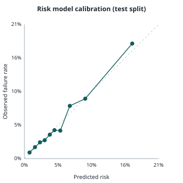

# Risk model report (RK-01)

Generated by `make risk-model` (scripts/train_risk.py). Trained on **synthetic data**
seeded from published rates; see docs/MODEL_CARD_risk.md. Production retrains on each
seller's own outcomes.

| Metric (held-out test split) | Value |
| --- | --- |
| Orders: train / validation / test | 72,000 / 24,000 / 24,000 |
| Failure base rate | 5.64% |
| PR-AUC (average precision) | 0.155 |
| PR-AUC of the true synthetic probabilities (ceiling) | 0.156 |
| Brier score | 0.0507 |
| Expected calibration error (10 equal-count bins) | 0.0048 |
| Trees | 186 |

PR-AUC is the right headline for a rare event: a random score would get the base rate.
The ceiling row shows the best any model could do on this synthetic data, since the
labels are random draws from known probabilities.

## Calibration

Platt scaling fitted on the validation split. Mean predicted risk vs observed rate per
bin (test split):

| Bin | Mean predicted | Observed | Orders |
| --- | --- | --- | --- |
| 1 | 0.81% | 0.96% | 2,400 |
| 2 | 1.65% | 1.79% | 2,400 |
| 3 | 2.43% | 2.54% | 2,400 |
| 4 | 3.17% | 2.88% | 2,400 |
| 5 | 3.98% | 3.75% | 2,400 |
| 6 | 4.70% | 4.46% | 2,400 |
| 7 | 5.62% | 4.38% | 2,400 |
| 8 | 7.10% | 8.25% | 2,400 |
| 9 | 9.52% | 9.38% | 2,400 |
| 10 | 16.87% | 18.00% | 2,400 |

## Reasons

Each score carries its top three exact TreeSHAP contributions (XGBoost
`pred_contribs`) in plain words, e.g. "Doorstep delivery instead of a locker raises the
risk". Monotone constraints keep every reason pointing the sensible way.
